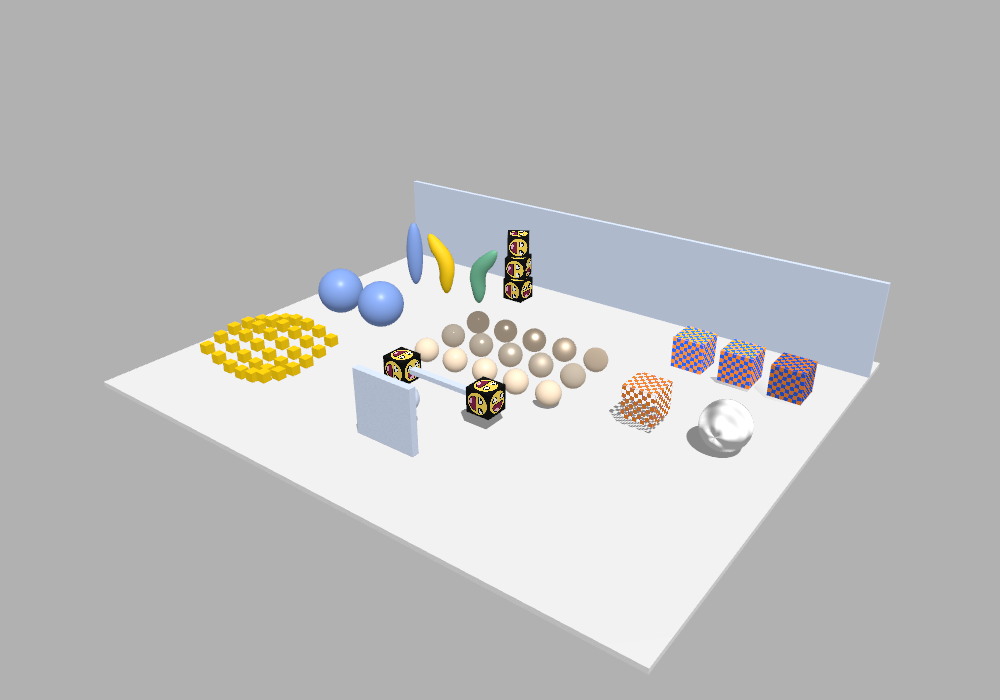
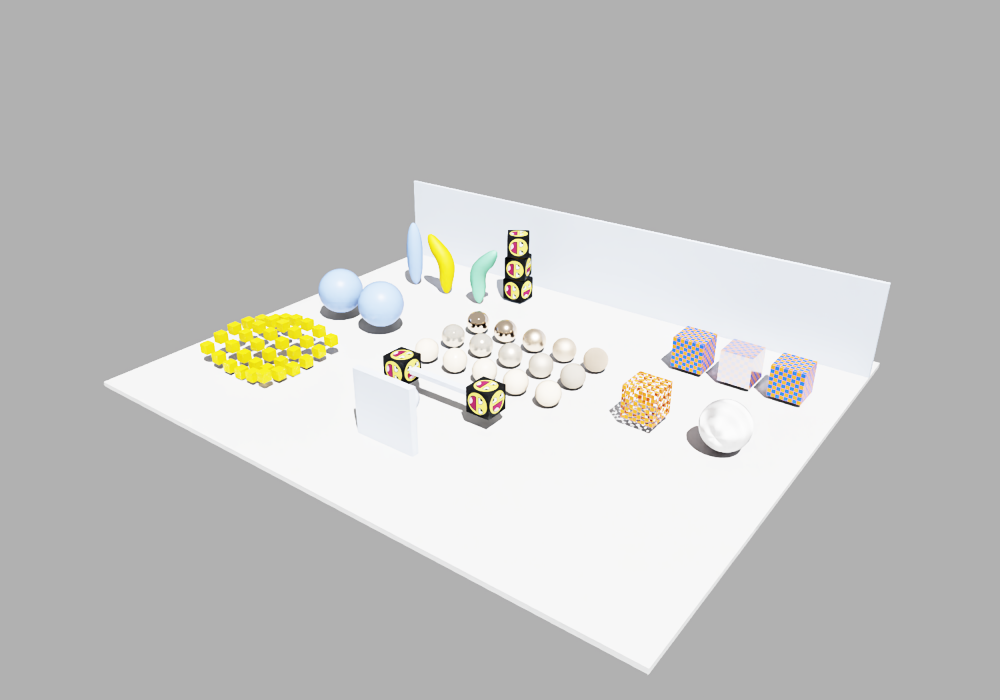
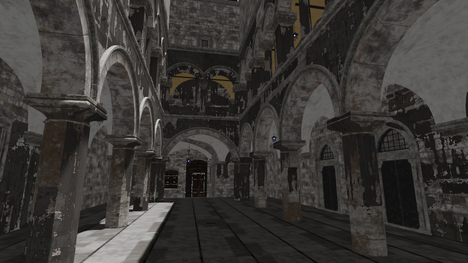
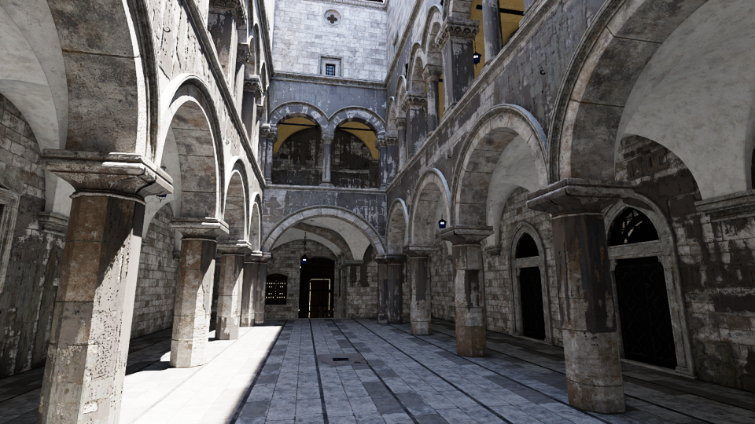
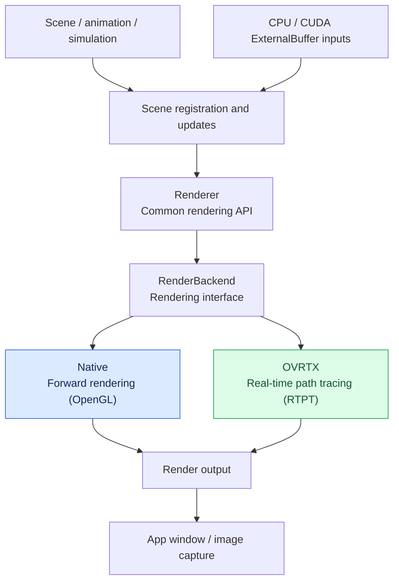

# OVRTX Renderer

KangEngine supports two renderers: **Native** (the default OpenGL renderer) and
**OVRTX** ([NVIDIA Omniverse RTX](https://github.com/nvidia-omniverse/ovrtx)).
Select a renderer when initializing your App; scene creation, animation, and
simulation APIs stay the same within the supported features below.

## Requirements and installation

Linux only; NVIDIA RTX GPU required.

After installing [KangEngine](getting_started/INSTALLATION.md):

```bash
pip install ovrtx==0.7.0.1794596436 ovstage==0.4.0.1794520352
pip install cuda-bindings  # Optional: CUDA instance inputs
```

## Native and OVRTX

The same scene, camera, and pose from `view_scene_renderer.py`, captured at
1000 × 700 with the UI hidden:

| Native | OVRTX |
| --- | --- |
|  |  |

Background colors are adjusted to the same displayed gray; scene lighting and
material inputs are unchanged.

Sponza from `view_usd_scene.py`, captured at 960 × 540 with the same camera,
sunlight, ambient, and exposure settings. OVRTX additionally uses an HDRI
aligned with the sunlight:

| Native | OVRTX |
| --- | --- |
|  |  |

Sponza 2022 — [Intel Sample Library](https://www.intel.com/content/www/us/en/developer/topic-technology/graphics-processing-research/samples.html).

| Feature | Native | OVRTX |
| --- | --- | --- |
| Rendering | Forward renderer (OpenGL) | Real-time path tracing (RTPT) |
| Environment lighting | Uniform diffuse lighting | HDRI-based lighting and reflections |
| Shadows | Shadow maps | Ray-traced shadows |
| Image processing | Configurable tone mapping, gamma, and bloom | OVRTX-managed output processing |

Both renderers use the same scene and simulation inputs and the `set_exposure()` API.

Lighting, reflections, shadows, and tone mapping differ, so the same material
values do not produce identical images. Rendering cost also differs; selecting
OVRTX does not change the physics backend.

## Usage

### App

From a source checkout, run the interactive comparison scene:

```bash
python ./python/examples/rendering/view_scene_renderer.py --renderer native
python ./python/examples/rendering/view_scene_renderer.py --renderer ovrtx
```

The Scene Controls panel toggles animation, materials, lights, and debug overlays.
Click objects to test picking. For an HDRI environment:

```bash
python ./python/examples/rendering/view_scene_renderer.py --renderer ovrtx --hdri-path environment.hdr
```

In your own App, pass `renderer="ovrtx"` to `initialize()`:

```python
import kangengine as ke


class ExampleApp(ke.App):
    def setup(self):
        material: ke.material.PBRMaterial = self.create_pbr_material(roughness=0.5)
        mesh: ke.scene.MeshData = ke.geometry.create_cube_data(scale=1.0)
        self.scene.add_mesh(path="/cube", mesh_data=mesh, material=material)
        self.set_camera_view(position=[3, 2, 4], target=[0, 0, 0])


app: ExampleApp = ExampleApp()
try:
    app.initialize(width=1280, height=800, renderer="ovrtx")
    app.start()
finally:
    app.close()
```

Omit `renderer` or use `renderer="native"` for Native. Do not pass
`graphics_backend_type` when selecting OVRTX.

For [Newton](NEWTON.md), use `NewtonViewer(renderer="ovrtx")`.
For [MimicKit](MIMICKIT.md), set `renderer: ovrtx` in the engine configuration.

For an App without a window, set `headless=True, hide_ui=True` during
initialization.

### Standalone scene images

To save a scene image without an App, run:

```bash
python ./python/examples/rendering/static_scene_renderer.py --renderer ovrtx --output scene.png
```

This uses `ke.render.SceneRenderer`, which returns an owned, top-down RGB
`uint8` array with shape `(height, width, 3)`. It renders meshes, supported
materials, lights, and a perspective camera authored in the scene, evaluating
scene changes on each `render()` call. Use App for runtime skinning, deformation,
and CPU/CUDA ExternalBuffer instance updates, including simulation visuals.

## Supported features

The following features apply to App with `renderer="ovrtx"`:

- Static meshes, independent skinned characters, CPU deformation, and CPU/CUDA
  instances, including rigid-body and articulation visuals.
- Color, Phong, and PBR materials; unlit rendering, alpha masking, double-sided
  surfaces, and shadow controls.
- File and pixel-array textures for base color, normals, alpha, PBR emission,
  metallic, and roughness.
- Directional, point, spot, rectangle, and dome lights; exposure and solid
  background color. Changing the background preserves dome illumination.
- Picking, selection outlines, mesh-based debug geometry, skeletal visuals,
  overlay points/lines/axes/arrows, and world/screen text.

## Limitations

These are limits of the current KangEngine integration, not OVRTX.

| Feature | Current behavior |
| --- | --- |
| Transparency | `MASK` works. Lit PBR `BLEND` uses USD opacity, preserving reflections and emission rather than fading the whole surface. Color/Phong and unlit `BLEND` are unsupported. |
| Mesh vertex colors | Unsupported. Colored debug points are supported. |
| Material maps | Packed metallic-roughness/ORM, occlusion, and specular maps are unsupported. |
| Texture sampling | File textures require `flip=True`; all textures require linear mipmapped filtering. Default texture loader settings are compatible. |
| Textured instances | Base-color/alpha-textured ExternalBuffer batches require one shared tint. Different per-instance colors work without those textures. |
| Checker materials | `DebugChecker` is unsupported. App's standard checker ground requires `use_pbr=True`, `grid_emission=0`, and opaque colors in `[0, 1]`. |
| Native effects | `set_tone_map()`, `set_gamma()`, bloom, wireframe, and custom OpenGL draws remain Native-only. Use `set_exposure()` for common brightness control. |
| Lights and background | Point/spot lights use inverse-square falloff without Native's range cutoff. Background color requires alpha `1`. |
| World raycast | As with Native, `app.raycast()` queries static mesh triangles with CPU transforms; it excludes skinned/deformed geometry and GPU-only transforms. Screen picking is separate. |

Unsupported material features raise an error when submitted. An example may
therefore need a different material or effect setting in addition to changing
`--renderer`.

For material and texture usage, see
[Materials and Textures](scene_rendering/MATERIALS_TEXTURES.md).

## Shared rendering interface

App scene and simulation data reach both renderers through the same rendering
interface. Each renderer manages its own resources and execution.



This shows the shared contract; internal data paths and supported features differ.

OVRTX overlays use [SPG](https://nvidia-omniverse.github.io/ovrtx/0.7.0/spg/overview.html):
rendered color + depth -> debug/text overlays -> output image.
