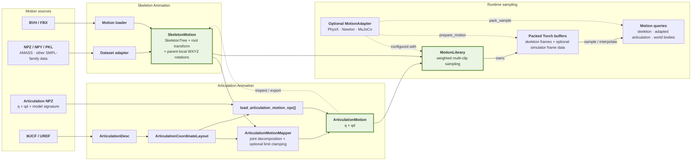

# Articulation Motion

- `SkeletonMotion` stores character poses as a world-space root translation, a world-space root rotation, and parent-local joint rotations, with all rotations represented as WXYZ quaternions.
- `ArticulationMotion` stores a sampled articulation trajectory as frame-major generalized configurations `q` and generalized tangent velocities `qd`, arranged according to an `ArticulationCoordinateLayout`.

Use this conversion when preparing animation data for robot control, motion
tracking, or simulation datasets.

## Motion data flow

KangEngine normalizes animation files and dataset-specific arrays into
`SkeletonMotion`. An articulation layout can then map the same motion into
`ArticulationMotion`. `MotionLibrary` accepts `SkeletonMotion` and articulation
motions that can be converted back to that representation, then provides packed
sampling and optional backend-native state generation.



## Convert a motion

Build the layout from the same `ArticulationDesc` used by the simulator. The
layout preserves the loader's BFS or DFS body order.

```python
import kangengine as ke

data = ke.asset.MJCFLoader.load(mjcf_path, order="DFS")
layout = ke.animation.ArticulationCoordinateLayout.from_data(
    data=data,
    free_root=True,
)
mapper = ke.animation.ArticulationMotionMapper(layout)

result = mapper.to_articulation_motion(skeleton_motion)
articulation_motion = result.motion

q = articulation_motion.q    # [frames, layout.nq], float32 NumPy view
qd = articulation_motion.qd  # [frames, layout.nv], float32 NumPy view
```

`residual_angles` reports, in radians, rotation that joint decomposition could
not represent. When `clamp_to_limits=True`, the residual also includes error
introduced by limit clamping. Use it to detect unsuitable mappings or motions
outside the robot's range.

## Coordinate layout

Each `layout.blocks` entry describes one joint coordinate block and its offsets
inside `q` and `qd`.

| Joint type | `q` value | `q` dimension | `qd` value | `qd` dimension |
|---|---|---:|---|---:|
| Fixed | none | 0 | none | 0 |
| Revolute | angle | 1 | angular velocity | 1 |
| Prismatic | position | 1 | linear velocity | 1 |
| Spherical(Ball) | quaternion `(w, x, y, z)` | 4 | angular velocity `(x, y, z)` | 3 |
| Free root | position `(x, y, z)` + quaternion `(w, x, y, z)` | 7 | linear velocity `(x, y, z)` + angular velocity `(x, y, z)` | 6 |

Therefore `layout.nq` and `layout.nv` may differ. Quaternion orientations use
four configuration values but have only three tangent velocity coordinates.

The layout also contains a `model_signature`. Mappers and backend adapters
require matching signatures. `load_articulation_motion_npz()` instead requires
matching `nq` and `nv`; it warns but still loads when only the signature differs.
This permits compatible extensions, but the warning may indicate a different
body order, joint layout, reference pose, or limits.

## Convert back for inspection

Convert the complete clip back to `SkeletonMotion` for visualization or BVH
export:

```python
preview_motion = mapper.to_skeleton_motion(articulation_motion)
```

Single poses can be converted in either direction:

```python
mapped = mapper.to_articulation_coordinates(skeleton_state)
restored_state = mapper.to_skeleton_state(mapped.q)
```

`SkeletonState` and `SkeletonMotion` cannot represent prismatic joints. An
`ArticulationMotion` containing prismatic joints therefore cannot be converted
back to either representation.

## Reference motion library

`MotionLibrary` accepts `SkeletonMotion` or `ArticulationMotion` clips. It stores
a skeleton representation and, when given an adapter, prepares engine-specific
coordinates once at registration. Articulation clips containing prismatic
joints cannot be registered because they cannot be represented by the skeleton
rotation tracks.

```python
import kangengine as ke

adapter = ke.adapters.physx.PhysXMotionAdapter(layout)
library: ke.animation.MotionLibrary = ke.animation.MotionLibrary(
    motions=[walk_motion, run_motion],
    adapter=adapter,
    device="cuda:0",
)

arti, body = library.sample_robot_state(
    motion_ids=[0, 1], times=[0.25, 0.75], loop=True,
)
joint_position = arti.joint_pos
body_position = body.body_pos_w
```

For training, load the library once and call `sample_robot_state()` for joint
and body targets at each reference time. There is no need to access or combine
the stored buffers directly.

For repeated training queries, call `library.compile()` once after loading and
selecting the device. The existing sampling and FK methods then use
`torch.compile`; omit the call for normal execution in viewers or short scripts.
Pass device tensors for motion IDs and times to avoid repeated host uploads.

```python
library.compile()
arti, body = library.sample_robot_state(motion_ids=motion_ids, times=motion_times)
```

Each used path compiles on its first call, which can take several seconds.
Batch sizes are dynamic, but new ranks, dtypes, or query options may recompile.
Adding clips or moving devices rebuilds compiled paths on demand. Compiler
errors propagate; there is no automatic fallback. Availability depends on the
installed PyTorch compiler backend and toolchain.

Choose the representation you need:

| Query | Result |
| --- | --- |
| `sample_skel_state()` | `SkeletonMotionState`: root position, local WXYZ rotations, root velocities |
| `sample_arti_state()` | Adapter-native motion: PhysX DOFs, MuJoCo `qpos/qvel`, or Newton `joint_q/joint_qd` |
| `sample_body_state()` | `BodyMotionState`: world-space body positions, WXYZ rotations, and velocities |
| `sample_robot_state()` | Always `(arti, body)`, using one shared frame lookup |

These are kinematic reference samples, independent of live simulation. Skeleton
queries never invoke the adapter. Articulation and robot queries require one.

Source and robot body fields share the names `body_pos_w`, `body_quat_wxyz_w`,
`body_vel_w`, and `body_ang_vel_w`. The final `_w` denotes world coordinates;
`wxyz` specifies quaternion component order.

With an adapter, body tracks are computed once from the converted robot poses,
including the robot's fixed joints and allowed rotation axes. Source skeleton
tracks remain unchanged. Without an adapter, body queries use the source pose.
This does not enforce joint limits or preserve contacts.

Body poses and velocities are precomputed by default. Set
`precompute_kinematics=False` to save storage; body queries then run FK and return
`None` for velocities, using interpolated local robot poses when adapted.
Interpolating stored world body tracks need not match FK of interpolated joint
coordinates. For FK of a particular interpolated skeleton pose, call
`forward_kinematics(sample=skel)` with a `sample_skel_state()` result.

For body poses consistent with sampled PhysX joint values, pass the articulation
state instead. This uses the PhysX adapter's joint order and runs on the library
device; both FK paths return `None` for velocities.

```python
arti: ke.adapters.physx.PhysXMotionState = library.sample_arti_state(
    motion_ids=0, times=0.25,
)
body: ke.animation.BodyMotionState = library.forward_kinematics(sample=arti)
```

Articulation-state FK currently supports PhysX revolute joints, including grouped
rotation-vector joints. Newton/MuJoCo states and prismatic joints are unsupported.
`sample_robot_state()` still interpolates cached body poses independently.

### Query exact frames

All four queries accept either `times` in seconds or integer `frame_ids`.
IDs and times/frames broadcast on the library device. Frame queries select
stored frames directly, without interpolation.

Batch queries require motion IDs in `[0, library.num_motions)`. They do not
validate ID ranges on each query; use `sample_motion_ids()` or `motion_id(name)`
to obtain valid IDs.

```python
arti, body = library.sample_robot_state(
    motion_ids=[0, 1], frame_ids=[10, 20], loop=False,
)

motion: ke.animation.MotionView = library.motion(motion_id=1)
arti, body = motion[20]
last_arti, last_body = motion[-1]
num_frames = len(motion)
```

`motion(id)` holds a reference to the library and copies no clip tensors. Its
integer indices are local to that clip, support negative indexing, and raise
`IndexError` outside the clip. Slices are not supported. The view continues to
resolve the clip after the library adds motions or moves device.

Batch queries use `loop=True` to wrap times or frame IDs; `loop=False` clamps
them to the clip endpoints. Unlike the single-clip view, batch queries therefore
wrap or clamp out-of-range frames. `interpolate=False` selects the preceding
frame for time queries.

### Access stored buffers

Use these views for custom kernels such as Warp or whole-clip analysis.
For time-sampled targets, use the sampling methods above.

```python
source: ke.animation.MotionLibraryBuffers = library.source_buffers()
adapted: ke.adapters.physx.PhysXMotionState = library.adapted_buffers()
bodies: ke.animation.BodyMotionState = library.body_buffers()

root_frames = source.root_pos
body_frames = bodies.body_pos_w
joint_frames = adapted.joint_pos
clip_starts = source.frame_offsets
```

| View | Stored data |
| --- | --- |
| `source_buffers()` | Source skeleton frames, source FK tracks, and clip metadata |
| `adapted_buffers()` | Motion converted to the engine's joint order and coordinates; requires an adapter |
| `body_buffers()` | World body poses and velocities computed from motion projected onto the robot's joints |

"Source" means the library's normalized skeleton data, not the original file
or the original `ArticulationMotion.q/qd` arrays. Without an adapter,
`body_buffers()` uses source skeleton FK instead. It requires
`precompute_kinematics=True` and does not run FK when called.
Use `source.body_pos_w` specifically when source skeleton positions are needed.

These methods return borrowed, read-only frame-major tensors spanning all clips.
They can be shared with runtimes such as Warp; acquire them again after adding
clips or calling `library.to(device)`. No repacking or tensor copying occurs when
requesting these views.

The read-only `library.adapter` property returns the adapter used to prepare
native data, or `None` for a skeleton-only library.

Original skeleton clips are not retained by default. Enable
`keep_source_motions=True` to access them through `source_motion(motion_id)` for
inspection or export. This is separate from the device-backed `motion(id)` view.

Use `sample_motion_ids()` for weighted clip IDs, `sample_times()` for random
times, or `sample_motion_times()` for both. `library.to(device)` moves stored
tensors without rebuilding clips.

For time sampling, callers must ensure `0 <= truncate_time <= duration` for
every selected clip. This constraint is not checked during sampling.

### Interpolation

Positions and native scalar joint coordinates interpolate linearly, including
PhysX multi-axis rotation-vector components. Angles are not wrapped or corrected
to the shortest path. Root, body, and native joint quaternions use SLERP.
Root, body, and joint velocities interpolate linearly in their respective
coordinate conventions; they are not necessarily
the exact time derivatives of the interpolated poses. Exact-frame queries and
`interpolate=False` return stored velocities directly. Scalar hinge interpolation
can differ from projecting an interpolated source skeleton rotation when it includes
off-axis components. Interpolated global body positions also need not equal FK
of interpolated joints.

Custom adapters implement `prepare_motion()` for registration, `frame_buffers()`
for typed views, and `pack_sample()` for interpolation of prepared frame pairs.
Internal adapter packing is not exposed by `source_buffers()`.

## Backend buffers

Backend adapters require only the canonical layout. The backend model or live
articulation can be checked explicitly before simulation, but it is not part of
reference motion storage or sampling.

### MuJoCo

```python
from kangengine.adapters.mujoco import MuJoCoMotionAdapter

adapter = MuJoCoMotionAdapter(layout)
adapter.validate_model(mj_model)  # optional compatibility check
buffers = adapter.pack(articulation_motion)
# buffers.qpos: [frames, layout.nq]
# buffers.qvel: [frames, layout.nv]

restored = adapter.unpack(
    buffers.qpos,
    buffers.qvel,
    fps=articulation_motion.fps(),
)
```

MuJoCo and canonical quaternions are both WXYZ. The adapter additionally
converts canonical free/ball angular velocities into MuJoCo's local tangent
frame.

### Newton

```python
from kangengine.adapters.newton import NewtonMotionAdapter

adapter = NewtonMotionAdapter(layout)
adapter.validate_model(newton_model)  # optional compatibility check
buffers = adapter.pack(articulation_motion)
# buffers.joint_q:  [frames, layout.nq]
# buffers.joint_qd: [frames, layout.nv]
```

The adapter handles Newton's XYZW quaternion storage. Optional validation also
checks grouped D6 offsets and authored axis order. The result remains one
reference trajectory; broadcasting it across worlds or selecting a different
frame per world belongs to the simulation or training layer.

### PhysX

```python
from kangengine.adapters.physx import PhysXMotionAdapter

adapter = PhysXMotionAdapter(layout)
adapter.validate_articulation(articulation)  # optional compatibility check
buffers = adapter.pack(articulation_motion)
# buffers.root_pos / root_quat_xyzw
# buffers.root_vel / root_ang_vel
# buffers.joint_pos / joint_vel
```

PhysX root state is separate from logical joint state. Authored scalar
revolute/prismatic DOFs use the stable canonical order. Native
spherical blocks currently raise `NotImplementedError` instead of silently
discarding rotation, because KangEngine's PhysX wrapper does not yet expose a
complete three-axis spherical state.
