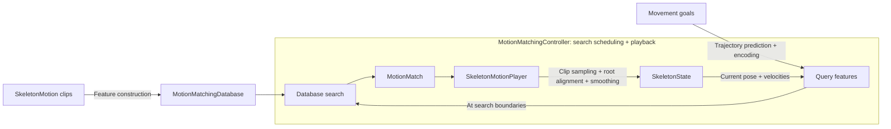

# Motion Matching

Motion Matching selects a frame from a motion database using the current pose
and desired trajectory, then plays the selected clip with root alignment and
optional transition smoothing.

The examples play kinematic root motion. Requested speed and direction
are approximate; physics tracking, collision checks, foot locking,
Motion Graph, and learned matching are not included.

## Quick Start

The example scripts require a repository checkout and an OpenGL graphical
session. Install the motion-matching extra, then prepare either dataset below.
Datasets are downloaded separately.

```bash
python -m pip install 'kangengine[motion-matching]'
```

### LAFAN / Geno setup

1. Download **BVH Data** from [lafan1-resolved](https://github.com/orangeduck/lafan1-resolved#download).
   Extract it and set `LAFAN_DIR` to the directory directly containing
   `pushAndStumble1_subject5.bvh`, `run1_subject5.bvh`, and `walk1_subject5.bvh`.
2. Download [Geno_bind.fbx](https://github.com/orangeduck/lafan1-resolved/blob/main/Geno_bind.fbx)
   into `assets/external/Geno/` (create the directory if needed).
3. From the repository root, run:

   ```bash
   python python/examples/animation/motion_matching_lafan.py --dataset "$LAFAN_DIR"
   ```

   The first run builds
   `output/motion_matching_lafan/database.npz` and its readable summary.
   Delete this NPZ when changing the dataset or feature settings.

### G1 / SEED setup

1. Obtain access to [BONES-SEED](https://huggingface.co/datasets/bones-studio/seed)
   through its dataset page, then download `g1.tar.gz` from **Files and versions**.
   The SOMA archives are not needed.
2. Set `SEED_DIR` to your extraction directory and extract the archive there:

   ```bash
   tar -xzf "$SEED_DIR/g1.tar.gz" -C "$SEED_DIR"
   ```

   The resulting layout is `g1/csv/{date}/{motion_name}.csv`. Preserve the CSV
   headers and subdirectories; the example searches recursively.
3. From the repository root, run:

   ```bash
   python python/examples/animation/motion_matching_g1.py --dataset "$SEED_DIR/g1/csv"
   ```

   It uses the repository's
   `assets/characters/g1/g1_29dof.xml` and builds the DB on each run.
   `CLIP_PREFIXES` selects locomotion families; up to three original takes per
   family and their available `_M` mirrors are included.

### Control playback

`LAFAN_DIR` and `SEED_DIR` are your chosen extraction directories. Use WASD or
the gamepad left stick to move, Shift or the right bumper to run, Space to
pause, and R to reset. Append `--benchmark-search` for a headless search check.

## Build a database

Prepare `motions`, a list of loaded `ke.animation.SkeletonMotion` clips,
using [Load and Play Motion](LOAD_MOTION.md). For example, collect compatible
loaded clips with `motions = [walk_motion, run_motion]` before the snippet below.
Clips must share joint names, hierarchy, and bind transforms; their FPS may differ. Convert
positions to meters during import. Rotations use WXYZ quaternions.

This configuration uses LAFAN joint names with Y-up and Z-forward:

```python
import kangengine as ke

config: ke.animation.MotionMatchingConfig = ke.animation.MotionMatchingConfig(
    position_joints=("LeftToeBase", "RightToeBase"),
    velocity_joints=("LeftToeBase", "RightToeBase", "Hips"),
    trajectory_times=(1 / 3, 2 / 3, 1.0),
    up_axis="Y",
    forward_axis="Z",
)
database: ke.animation.MotionMatchingDatabase = (
    ke.animation.MotionMatchingDatabase.from_motions(motions, config=config)
)
```

Walking features combine joint positions, joint velocities, future planar
positions, and future headings in the current reference frame. Only frames
with a complete future horizon are searchable; playback can reach the clip end.

## Playback and trajectory

Multiple controllers can share one database while keeping independent playback
and smoothing state. Search runs in C++ by default; `search_backend="python"`
selects the NumPy reference implementation.

```python
from kangengine.animation.matching import make_walking_query

controller: ke.animation.MotionMatchingController = (
    ke.animation.MotionMatchingController(database, transition_half_life=0.1)
)
state: ke.animation.SkeletonState = controller.step_with_query(
    dt=1 / 60,
    query_provider=lambda current: make_walking_query(
        current,
        desired_velocity=(0, 0, 1.4),
        facing_angle=0.0,
        half_life=0.2,
    ),
)
```

Velocity is a world-space planar vector in m/s. Facing is radians about
`up_axis`, measured from `forward_axis`. The returned state can be passed to a
compatible visual's `apply_state(state=state)`.

For constant-velocity goals without trajectory springs, use
`controller.step(dt=dt, desired_velocity=velocity)`.

| Parameter | Controls | Meaning of zero |
|---|---|---|
| `transition_half_life` | Decay of pose offsets after a clip switch; larger values smooth longer | Disable pose smoothing |
| Trajectory `half_life` | Predicted velocity/facing response to goals; larger values respond more gradually | Snap future velocity and facing to goals |
| `dt` | Elapsed playback time for this step, e.g. `1 / 60` at 60 Hz | Do not advance or search |

All three use seconds. See the query and playback reference below for callback
inputs, pose history, and search timing.

## Save and load

```python
database.save_npz("output/walking.npz", write_summary=True)
restored: ke.animation.MotionMatchingDatabase = (
    ke.animation.MotionMatchingDatabase.from_npz("output/walking.npz")
)
```

NPZ stores source motions, features, normalization, and reference tracks.
Loading rebuilds the search index without extracting features or running
filters. The optional `.summary.json` lists clip names, frame counts, and FPS
for inspection; it is not used during loading.

## Query and playback reference

- `MotionMatchingDatabase` builds, normalizes, stores, and searches features.
- `MotionMatchingController` schedules searches and owns independent playback.
- `WalkingFeatures` supplies ground-plane features; custom builders can replace it.



### Query inputs

`query_provider(current)` receives this controller at the current playback time
and must return normalized, weighted query features with shape `[D]`.
`make_walking_query()` uses the current smoothed output positions and finite-difference velocities,
with a predicted trajectory from movement goals. `controller.make_query(...)`
uses the same current pose with caller-supplied trajectory features. External
physics or IK results are not read automatically; pass world-space
`joint_positions`, `joint_velocities` (both `[J,3]` in skeleton order),
`skeleton_tree`, and `reference_position`/`reference_rotation_wxyz` to
`database.make_query(...)` to use them. Without `joint_positions`, the database
method samples cached source-clip features.
The callback must not mutate or re-enter the controller.

### Pose history

`MotionMatchingController(..., history_size=10)` retains output poses in
`controller.history`, oldest first. The size must be at least 2. Each positive
step appends one pose; reset clears the history and stores the initial pose.
Clip switches preserve it, and `dt=0` adds nothing. No timestamps are stored.
Query velocities use only the previous output and current joint positions
divided by their elapsed `dt`; they are zero immediately after reset. Internal
search boundaries use partial-step time without adding history entries.
Changing step sizes changes the difference interval and can change search results.
Smoother and trajectory spring velocities retain their existing calculation.

### Search scheduling

A search boundary occurs on the first positive step after reset, every
`search_interval` seconds (default `0.15`), or when the active clip ends.
`step_with_query()` splits `dt` at those boundaries: the callback can run zero,
one, or several times in one step. Between searches, the selected clip advances.
With `dt=0`, playback is sampled without advancing or calling the provider.

### Trajectory prediction

`predict_walking_trajectory()` accepts the same goal inputs and returns world
positions and directions with shape `(1 + len(trajectory_times), 3)`. The first
sample is the current reference; the remaining samples are future predictions.
It does not advance playback.

Low-level `trajectory_spring_position/rotation(dt=...)` also accept an array of
independent future time horizons; these are offsets from the supplied state,
not successive frame steps.

## Reference filtering

`WalkingFeatures()` leaves filtering off. To reduce gait-related sway in the
reference trajectory, pass a filtered builder during database construction:

```python
features: ke.animation.WalkingFeatures = ke.animation.WalkingFeatures(
    position_filter_window=2.0,
    rotation_filter_window=2.0,
)
database = ke.animation.MotionMatchingDatabase.from_motions(
    motions, config=config, feature_builder=features
)
```

Reference filtering uses SciPy's Savitzky-Golay function. Set a filter window to
`0` to disable it. Both examples enable filtering. The motion-matching extra
installs SciPy.

The filter creates a ground-plane reference track without changing the source
Hips motion, skeleton, or skin binding. Playback aligns this track across clip
switches; no additional Simulation joint is introduced. Reference position and
heading are continuous at a switch, but their velocities can change.

Use `controller.reference_position`, `reference_rotation_wxyz`,
`reference_linear_velocity`, and `reference_angular_velocity` for trajectory
queries. The `root_*` properties describe the actual output root. Without an
explicit reference track, reference properties fall back to the output root
and its heading. Runtime prediction does not rerun the offline filter.

## Examples

Use the explicit `--dataset` paths in Quick Start on any machine.
`--benchmark-search` compares native and NumPy search results and warmed timings
without opening a viewer; database construction and playback are not timed.
Character, clip selection, and filter settings are constants in each example.

Enable **Show foot contacts** to visualize [kinematic contact estimates](FOOT_CONTACT.md).

### LAFAN and Geno

The selected ranges and mirrored copies follow
[GenoViewPython-MotionMatching](https://github.com/orangeduck/GenoViewPython-MotionMatching).

| File | Frame range (zero-based, end excluded) |
|---|---|
| `pushAndStumble1_subject5.bvh` | `[397:706]` |
| `run1_subject5.bvh` | `[172:14136]` |
| `walk1_subject5.bvh` | `[160:15518]` |

Each range is sampled at 60 FPS and included with a left/right mirrored copy.
Positions are converted from centimeters to meters. The long clips provide
walking, running, stopping, and turn coverage.

Geno is loaded through `SkinVisual.from_fbx(..., skeleton_tree=...)`, using
the database skeleton and matching bones by name. This requires compatible bone
frames and proportions; it does not perform retargeting. The FBX loader handles
bind-space conversion, so the example does not transform mesh vertices again.

The reference track uses projected Hips motion. Fixed non-root offsets
approximate small BVH translation variations; the example does not reproduce
the reference application's Simulation-joint playback exactly.

### G1

G1 converts SEED CSV data to `ArticulationMotion`, then to `SkeletonMotion`
for matching: native 120 FPS, Z-up, root positions in cm -> m, and joint angles
in degrees -> radians. Its final output is projected onto the robot's joint limits.
See [Articulation Motion](ARTICULATION_MOTION.md) for the conversion API.

## Custom features

A builder implements `describe(config)`, `build_clip(...)`, and
`make_query(...)`. It owns feature coordinates and query inputs; the database
handles normalization and search. Use `step_with_query()` for a custom movement
model. By default, root placement aligns the reference track, or the source
root when no reference track exists. A custom
`root_placement(source_state, current_state)` callback returns a rigid
`(rotation_wxyz, translation)` mapping source poses into world space;
translation is in meters. It runs on reset and transitions, with
`current_state=None` on reset. Its transform is held until the next transition;
it is not a per-frame root override.

`python/examples/animation/motion_matching_custom.py` adds a root-height feature
to the LAFAN database. Run the LAFAN example first to create its NPZ. The custom
example rebuilds features in memory and runs without a viewer.

When loading a custom database, pass its builder to `from_npz(feature_builder=...)`
with matching schema metadata. Keep builder settings unchanged after creation.
