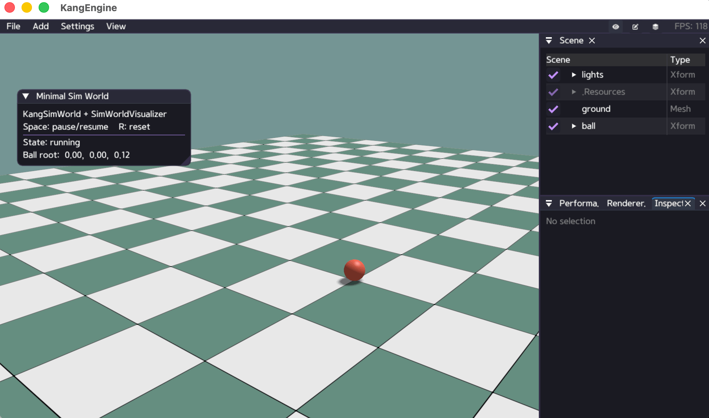

# Camera and Viewer

Set an initial camera with the application helper:

```python
self.set_camera_view(
    [3.0, -4.0, 2.2],
    [0.0, 0.0, 0.7],
)
```

For direct control:

```python
camera = self.get_camera()
camera.set_near_plane(distance=0.05)
camera.set_far_plane(distance=5000.0)
camera.set_fov(fov=58.0)
camera.set_camera_pos(position=ke.Vec3(0.0, 4.0, 14.0))
camera.set_target_pos(target=ke.Vec3(0.0, 1.0, 0.0))
```

Use `ke.keys` in lifecycle callbacks for keyboard interaction and `ke.imgui`
for small panels. See `python/examples/sim_world_minimal.py` for pause/reset
controls and a state panel.

Viewer capture shortcuts:

- `T`: save one screenshot.
- `Shift+T`: start or stop video recording.



## World-space ray queries

Call `app.raycast(origin=..., direction=...)` with world-space `ke.Vec3` values.
It returns the nearest triangle hit without changing selection. Check `hit`
before reading `position`, `distance`, `handle`, or `instance_index`.
`prim` is available for scene-owned transforms; external instance batches return
`None`. The direction must be finite and nonzero; it is normalized internally.

Queries use the latest frame update or explicit transform upload, including
objects outside the camera view. They skip inactive, hidden, non-pickable,
skinned/deformed meshes, GPU-only transforms, and singular transforms. Both
triangle sides are tested; material alpha and texture cutouts are ignored.
Screen clicks still use GPU picking at the current animated pose.
`ray_pick()` remains an alias.
