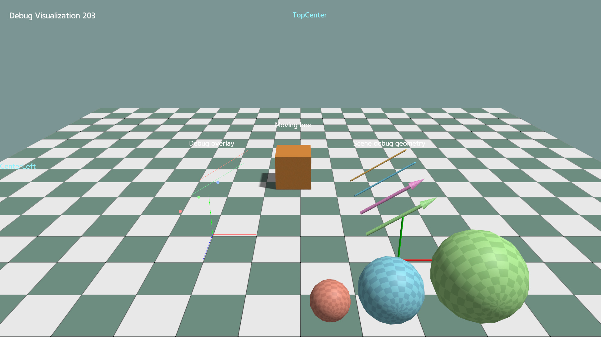

# Debug Visualization and Text Rendering

Use `app.debug` as the entry point for debug visualization and text:

- `app.debug.overlay` draws graphics API line and point primitives through the
  debug render pass, without creating scene Prims or mesh objects. Axes and
  arrows are built from line segments.
- `app.debug.geometry` creates triangle-mesh debug objects in the SceneGraph
  and draws them through the scene renderer, using instancing for batches.
- `app.debug.world_text` draws screen-aligned text at a 3D world position.
- `app.debug.screen_text` draws text in viewport pixel coordinates.

Both drawing paths ultimately use the graphics API. Overlay uses line widths
and point sizes in pixels; geometry uses mesh dimensions such as radii in world
units.

`app.debug` groups the existing helpers; it is not a SceneGraph node or a
separate data store. Only `geometry` creates scene objects, owned by the current
scene. Overlay and text entries do not appear in the scene graph panel.

| Helper | Create or update | Show or hide | Remove |
| --- | --- | --- | --- |
| `app.debug.overlay` | Call `lines()`, `points()`, `axes()`, or `arrows()` again at the same path | `set_visible(path, visible)` | `remove(path)`, `remove_all()` |
| `app.debug.geometry` | Create with `add_*()`, then call `update_*()` on the returned view | `view.set_visible(visible)` | `view.remove()` |
| `app.debug.world_text` / `app.debug.screen_text` | `set()` replaces an entry; `set_text()` and `set_position()` update individual fields | `set_visible(path, visible)` | `remove(path)`, `remove_all()` |

Geometry is managed through its returned scene-object view. Overlay and text
are managed by path. Use `app.debug.*` for new code; overlay `clear*()` methods
remain available to empty data while retaining reusable buffers.

The previous entry points (`app.debug_overlay`, `app.scene.debug_geometry`,
`app.world_text`, and `app.screen_text`) still refer to the same helper objects.
Updates or removals through either entry point affect the same data.



## Debug overlay

Use `debug.overlay` for lightweight lines, points, axes, and arrows that do not
create SceneGraph Prims:

```python
self.debug.overlay.axes(
    path="/overlay/axes",
    origin=np.array([0.0, 0.0, 0.0]),
    rotation=np.eye(3),
    length=1.0,
)
```

Calling the same function with the same path creates or replaces its data and
options. This is also the update operation; there is no separate `update_*()`
method for overlay batches:

```python
self.debug.overlay.points(path="/overlay/contacts", points=contact_positions)
self.debug.overlay.points(path="/overlay/contacts", points=new_contact_positions)

self.debug.overlay.set_visible(path="/overlay/contacts", visible=False)
self.debug.overlay.set_visible(path="/overlay/contacts", visible=True)
self.debug.overlay.remove(path="/overlay/contacts")
self.debug.overlay.remove_all()
```

An overlay `path` is an exact string identifier, not a SceneGraph hierarchy.
Slashes only organize names for readability: `remove("/overlay")` does not remove
`"/overlay/axes"`. Use the complete identifier to manage an entry.

Lines, axes, and arrows share one set of identifiers, so drawing any of them at
the same path replaces the previous line, axis, or arrow data. Points use a
separate set and can coexist at that path. `set_visible(path, visible)` and
`remove(path)` affect both at that exact path. An unknown path is a no-op.

`set_visible()` retains data so it can be shown again without resending it.
The next draw call replaces the batch's options too, including `hidden`.
`remove()` deletes an entry and releases its buffers; `remove_all()` does this
for every overlay entry. These calls do not remove scene objects or text.

For frequently reused paths, `clear_lines(path)`, `clear_points(path)`, and
`clear(path)` remain available to empty data while retaining reusable buffers.
`clear(path)` empties both line and point data. These methods do not remove
entries or match path prefixes.

Lines, points, axes, and arrows normally test scene depth (`overlay=False`).
Pass `overlay=True` to any of these helpers to keep them visible through meshes
without changing their world positions.

For force arrows, convert forces to displayed world-space lengths with a shared
scale. `starts` and `ends` have shape `(N, 3)`; optional RGBA `colors` have shape
`(N, 4)`, or `(1, 4)` / `(4,)` for one shared color:

```python
self.debug.overlay.arrows(
    path="/overlay/forces",
    starts=contact_positions,
    ends=contact_positions + forces * force_scale,
    width=3.0,
    overlay=True,
)
```

Each arrow uses a shaft and four head segments. The head length is 20% of the
arrow length, with an 8% half-width. Arrows of length at most `1e-8` are omitted;
an empty batch clears the previous arrows while retaining reusable buffers.

## Scene debug geometry

`debug.geometry` creates mesh-based, instanced SceneGraph renderables.
Keep the returned view to update or remove them:

```python
self.debug_spheres = self.debug.geometry.add_spheres(
    path="/debug_geometry/spheres",
    centers=centers,
    radii=radii,
    colors=colors,
)

self.debug_spheres.update_spheres(
    centers=new_centers,
    radii=radii,
    colors=colors,
)
self.debug_spheres.remove()
```

Lines and arrows provide matching `update_lines()` and `update_arrows()`
methods.

## World-space text

Create the entry once, then update only the values that change:

```python
self.debug.world_text.set(
    path="/labels/box",
    text="Box",
    position=ke.Vec3(0.0, 1.2, 0.0),
    pixel_size=28.0,
)

self.debug.world_text.set_position("/labels/box", new_position)
self.debug.world_text.set_text("/labels/box", "Moving box")
self.debug.world_text.set_visible(path="/labels/box", visible=False)
self.debug.world_text.set_visible(path="/labels/box", visible=True)
self.debug.world_text.remove(path="/labels/box")
self.debug.world_text.remove_all()
```

Set `depth_test=False` when the label should remain visible through scene
geometry.

Repeating `set()` replaces the complete entry, including its options.
`set_text()` and `set_position()` update only the specified field and preserve
visibility. `set_visible()`, `remove()`, and `remove_all()` follow the same
management convention as `debug.overlay`, but affect only world text.

## Screen-space text

`position` is measured in pixels from the selected anchor. Without an explicit
anchor, it uses `TopLeft`, so `(24, 24)` places the text 24 pixels right and
down from the top-left corner:

```python
self.debug.screen_text.set(
    path="/status",
    text="Ready",
    position=ke.Vec2(24.0, 24.0),
    anchor=ke.render.ScreenAnchor.TOP_LEFT,
)

self.debug.screen_text.set_text("/status", "Running")
self.debug.screen_text.set_visible(path="/status", visible=False)
self.debug.screen_text.remove(path="/status")
self.debug.screen_text.remove_all()
```

When `alignment` is omitted, it follows the anchor column automatically:
left, center, or right. Pass an explicit alignment to override it.

Screen text has the same update and management methods as world text; its
`remove_all()` affects only screen text. For existing callers, text helpers
retain `set_hidden(path, hidden)` and `clear()` as compatibility spellings of
`set_visible(path, not hidden)` and `remove_all()`.

Run the complete example:

```bash
python ./python/examples/debug_visualization.py
```

The yellow arrow follows the moving box and starts at its center. It uses
`debug.overlay.arrows(..., overlay=True)` so the shaft remains visible through
the box, and reuses the same path each frame to update its position.

<details>
<summary>Complete source: <code>debug_visualization.py</code></summary>

```{literalinclude} ../../../../python/examples/debug_visualization.py
:language: python
:linenos:
```

</details>
