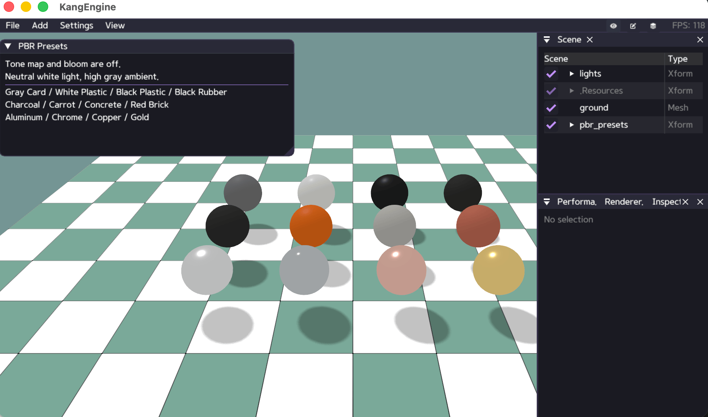

# Materials and Textures

Materials describe how a mesh surface should look. This page shows how to use
the built-in materials, create independent Phong and PBR materials, attach
textures, and assign the result to a scene mesh.

Most applications only need `self.scene` and `ke.material`. The custom graphics
pipeline section at the end is optional and intended for rendering experiments.

Examples assume `import kangengine as ke` and run inside an `App` subclass, so
the current application and its scene are accessed as `self` and `self.scene`.

## API namespaces

Use these APIs for scene objects, materials, and textures:

| Namespace | Use it for |
| --- | --- |
| `self.scene` | Adding meshes, ground planes, and imported assets to the scene |
| `ke.material` | Creating and configuring materials |
| `ke.render` | Working with GPU resources and custom drawing |

For ordinary meshes, create a material and pass it to
`self.scene.add_mesh()`.

## Standard materials

`create_standard_materials()` returns a collection of reusable materials for
meshes, ground planes, and characters. Repeated calls return the same materials;
`force=True` creates a new collection.

The simplest ground call automatically uses the shared checkerboard material
from this collection:

```python
ground = self.scene.add_ground()
```

Get the collection directly when you want to reuse one of its materials or
replace the ground material explicitly:

```python
materials = self.create_standard_materials()
ground = self.scene.add_ground(
    path="/diagnostic_ground",
    material=materials.debug_checker,
)
```

Available materials:

| Name | Purpose |
| --- | --- |
| `common`, `debug`, `skinned`, `skinned_debug` | One color per object, with optional colors per vertex |
| `common_texture`, `skinned_texture` | Image texture tinted by object and vertex colors |
| `ground` | Checkerboard ground |
| `debug_checker`, `skinned_debug_checker` | Grid for checking texture placement (UV coordinates) |
| `phong`, `skinned_phong` | Default Phong surface |
| `pbr`, `skinned_pbr` | Default PBR surface |

These are shared defaults. Changing one changes every object using that same
material. Create a separate material to change one object's appearance independently.

## Create a Phong material

Phong controls surface color (`diffuse`), highlight color (`specular`), and
highlight sharpness (`shininess`).

```python
material: ke.material.PhongMaterial = self.create_phong_material(
    diffuse=ke.Vec3(0.8, 0.3, 0.1),
    specular=ke.Vec3(0.2, 0.2, 0.2),
    shininess=32.0,
)

mesh: ke.RenderablePrimView = self.scene.add_mesh(
    path="/orange_mesh",
    mesh_data=mesh_data,
    material=material,
)
```

`create_phong_material()` creates a new material owned by the App on every call.
Available texture inputs are `diffuse_map`, `specular_map`, `alpha_map`, and
`normal_map`.

## Create a PBR material

PBR (physically based rendering) controls how metallic (`metallic`) and rough
(`roughness`) a surface looks. The fourth `base_color` value is opacity:
`0` is transparent and `1` is opaque. Transparency also requires `MASK` or
`BLEND` mode, as shown under [Mesh rendering options](#mesh-rendering-options).

```python
material: ke.material.PBRMaterial = self.create_pbr_material(
    base_color=ke.Vec4(0.8, 0.3, 0.1, 1.0),
    metallic=0.0,
    roughness=0.6,
)

mesh: ke.RenderablePrimView = self.scene.add_mesh(
    path="/pbr_mesh",
    mesh_data=mesh_data,
    material=material,
)
```

Switching from Phong to PBR does not automatically convert `diffuse` and
`shininess` into `base_color` and `roughness`.

## Load and attach textures

`App.load_texture()` loads an image and keeps the texture alive while the App
is open. Loading the same file with the same `flip` and `srgb` settings reuses
the texture. `flip=True` (the default) flips the image vertically.

Use `srgb=True` for color images stored as sRGB. Images storing surface data,
such as normals, roughness, or metallic values, use `srgb=False` (the default).

For generated images, use `App.create_texture(pixels, srgb=True)`. `pixels`
must be a contiguous `uint8` NumPy array with shape `(height, width, 3)` for RGB
or `(height, width, 4)` for RGBA. It copies the source; later edits to the array
do not change the texture. Create and assign a new texture to replace it.
The `flip` and `srgb` settings match `load_texture()`.

Phong example:

```python
diffuse: ke.render.Texture = self.load_texture(
    path="assets/wood_base_color.png",
    srgb=True,
)
normal: ke.render.Texture = self.load_texture(path="assets/wood_normal.png")

material = self.create_phong_material(
    diffuse=ke.Vec3(1.0, 1.0, 1.0),
    diffuse_map=diffuse,
    normal_map=normal,
)
```

PBR example with a combined ORM image: red stores ambient occlusion (darkening
in crevices), green stores roughness, and blue stores metallic values.

```python
base_color: ke.render.Texture = self.load_texture(
    path="assets/metal_base_color.png",
    srgb=True,
)
orm: ke.render.Texture = self.load_texture(path="assets/metal_orm.png")

material = self.create_pbr_material(
    base_color=ke.Vec4(1.0, 1.0, 1.0, 1.0),
    base_color_texture=base_color,
    orm_texture=orm,
)
```

Material colors multiply the texture colors. Use white `diffuse` or `base_color`
to display an image without an additional tint.

For a separate PBR transparency mask, pass `opacity_texture` to
`create_pbr_material()`. Load it with `srgb=False`; its red channel replaces
the base-color texture's alpha and is multiplied by the fourth `base_color` value.
Set the mesh alpha mode to `MASK` or `BLEND` to enable transparency.

OBJ/MTL imports group faces by material and attach supported diffuse, specular,
alpha, and normal textures automatically. See
[Load Assets](LOAD_ASSETS.md) for the import workflow.

## Store texture paths in an asset

For reusable assets, store image filenames in `texture_paths`. The App loads
them when it creates the visual:

```python
import kangengine as ke

paint: ke.material.PBRMaterial = ke.material.PBRMaterial()
paint.base_color = ke.Vec4(1.0, 1.0, 1.0, 1.0)
paint.metallic = 0.1
paint.roughness = 0.45
paint.texture_paths = {"base_color_texture": "textures/paint.png"}
paint.texture_srgb = {"base_color_texture": True}  # Defaults to False (linear).

# The getter returns a copy; assign the updated dictionary back.
paint.texture_paths = {
    **paint.texture_paths,
    "normal_texture": "textures/normal.png",
}
part: ke.asset.VisualGeomDesc = ke.asset.VisualGeomDesc(
    mesh_data=ke.geometry.create_box_data(x_scale=1.0, y_scale=0.6, z_scale=0.8),
    material=paint,
)
```

Use your own filenames and set the containing `RigidDesc.asset_dir` to their
base directory. Dictionary keys match material properties, such as
`base_color_texture` and `normal_texture` for PBR, or `diffuse_map` for Phong.
See [Load and attach textures](#load-and-attach-textures) for App texture loading.

`VisualGeomDesc` keeps its material alive. Each App creates its own materials
and textures from these descriptions, so the asset can be reused across Apps.
Already loaded GPU textures cannot be shared between Apps.

The part's `rgba` defaults to white with full opacity. For PBR, opacity multiplies
the part, `base_color`, and instance alpha values. OBJ opacity is stored in the
part's alpha.

## Mesh rendering options

Set whether a mesh casts shadows, is visible from both sides, or uses transparency:

```python
mesh: ke.RenderablePrimView = self.scene.add_mesh(
    path="/mesh",
    mesh_data=mesh_data,
    material=material,
)
mesh.set_casts_shadow(enabled=True)
mesh.set_double_sided(enabled=False)
mesh.set_alpha_mode(mode=ke.render.AlphaMode.OPAQUE)
```

Use double-sided rendering for surfaces that must be visible from both sides.
Use `AlphaMode.MASK` for fully visible or fully transparent cutouts, and
`AlphaMode.BLEND` for partial transparency.

These options apply per object for SceneGraph rendering and to the whole batch
for ExternalBuffer rendering. Shared dynamic geometry cannot be split by changing
one object's options after vertex updates; configure its options before updating
vertices.

## Color materials

`ColorMaterial` uses an object's color and optional colors stored at each vertex.
Choose a style for plain color, an image texture, or a checkerboard:

```python
plain: ke.material.ColorMaterial = self.create_color_material()

textured: ke.material.ColorMaterial = self.create_color_material(
    style=ke.material.ColorStyle.TEXTURED,
)
textured.base_color_texture = self.load_texture(path="textures/color.png", srgb=True)
textured.normal_texture = self.load_texture(path="textures/normal.png", srgb=False)

checker: ke.material.ColorMaterial = self.create_color_material(
    style=ke.material.ColorStyle.CHECKERBOARD,
)
debug_checker: ke.material.ColorMaterial = self.create_color_material(
    style=ke.material.ColorStyle.DEBUG_CHECKER,
)
```

`DEBUG_CHECKER` draws a grid to reveal stretched or missing texture coordinates (UVs).

Unlit rendering also samples `base_color_texture`.

Texture changes affect every object sharing the material. To change one object,
assign a copy with independent parameters and shared textures:

```python
copied_material: ke.material.Material = material.clone()
mesh.set_material(material=copied_material)
```

`mesh.set_batch_texture()` is a Native ColorMaterial override for the entire batch;
it takes precedence over the material texture. `set_texture()` remains its
compatibility alias. Use material fields for Phong and PBR textures.

`VertexColorMaterial`, `VertexColorStyle`, and `create_vertex_color_material()`
remain aliases of `ColorMaterial`, `ColorStyle`, and `create_color_material()`.

## Per-vertex colors

The `color` passed to `scene.add_mesh()` multiplies the material color for that
object without modifying the shared material. `prim.set_display_color()` changes
RGB while preserving alpha; `prim.set_display_color_alpha()` changes RGBA.

Basic surface RGB is multiplied per channel in linear space:

| Material | Surface RGB before lighting |
| --- | --- |
| `ColorMaterial` (plain) | object color × vertex color |
| `ColorMaterial` (textured) | texture color × object color × vertex color |
| `PhongMaterial` | `diffuse` × `diffuse_map` RGB × object color × vertex color |
| `PBRMaterial` | `base_color.rgb` × `base_color_texture` RGB × object color × vertex color |

Missing colors or textures act as white. Lighting, specular highlights, and
emission are calculated separately. Alpha follows the material's opacity inputs
and the mesh's alpha mode.

For a separate color at each vertex, pass `[N, 3]` **linear RGB** values when
creating the mesh.
The vertex array is `[N, 3]` and triangle indices are `[M, 3]`:

```python
mesh_data: ke.scene.MeshData = ke.scene.MeshData.from_arrays(
    vertices=vertices, indices=indices, colors=colors,
)
material: ke.material.ColorMaterial = self.create_color_material()
material.unlit = True
mesh: ke.RenderablePrimView = self.scene.add_mesh(
    path="/colored_mesh", mesh_data=mesh_data, material=material,
    color=ke.Vec4(1, 1, 1, 1),
)
```

`normals` is also optional and accepts `[N, 3]` values. Omitted normals are
generated from the triangles; omitted colors act as white. Vertex colors
multiply object and material colors in ColorMaterial, Phong, and PBR,
including skinned meshes. They contain RGB only; opacity comes from the
object and material. Editing `MeshData.colors` after scene registration does
not automatically update the rendered colors.

Convert colors from sRGB images to linear RGB before use.

## Display colors without lighting

ColorMaterial, PhongMaterial, and PBRMaterial support `unlit` (default `False`).

```python
material.unlit = True
```

With unlit rendering, the object's `color` is multiplied by any vertex colors
and the material values below:

| Material | Material color used |
| --- | --- |
| ColorMaterial | `base_color_texture` |
| PhongMaterial | `diffuse` × `diffuse_map` |
| PBRMaterial | `base_color` × `base_color_texture` |

Missing textures act as white. Phong `alpha_map` and PBR `opacity_texture`
use red-channel opacity instead of the color texture's alpha. Alpha mode and
cutoff still apply.

Unlit displays base color only, without lighting, received shadows, normal maps,
emission, or checker patterns. It does not disable shadow casting or the
renderer's final color adjustments. Set `material.unlit = False` to restore lighting, or
`mesh.set_casts_shadow(enabled=False)` to disable shadow casting separately.

`ColorStyle.UNLIT` also enables `unlit`; choosing another style disables it.
Setting `unlit=False` while using `ColorStyle.UNLIT` changes the style to `UNTEXTURED`.

## Materials share built-in shaders

KangEngine selects and reuses the appropriate built-in pipeline from the
material, mesh, and render settings. Creating many materials does not compile
the same built-in shader repeatedly.

The Resource panel lists shader sources and rendering variants, such as those
for static or skinned meshes and opaque or transparent surfaces.

## Custom rendering

Drawing geometry outside the normal scene-mesh path is an advanced workflow.
See [Custom Graphics Pipelines](../advanced/CUSTOM_GRAPHICS_PIPELINES.md) for
buffer layouts, shader stages, render hooks, resource tracking, and a runnable
triangle example.

## Examples

- `python/examples/test_phong_texture.py`
- `python/examples/view_obj_scene.py`
- `python/examples/view_pbr.py`
- `python/examples/view_pbr_presets.py`


