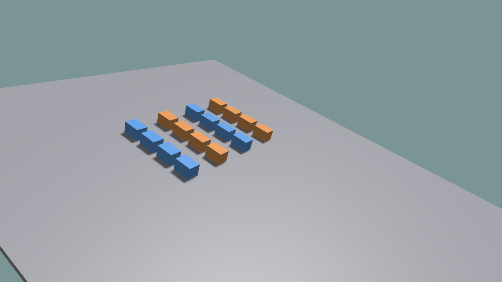

# Multi-Environment Simulation

Run multiple independent simulations in one world and read or update their
state as batches. Objects with the same `obj_id` form a batch across environments.

## Share one rigid description

Prepare `box_asset` as shown in [Rigid Bodies](RIGID_BODIES.md#prepare-a-rigid-description).
This CPU example creates a new world; release any previous viewer and world first.

```python
import kangengine as ke

world: ke.sim.KangSimWorld = ke.sim.KangSimWorld(
    num_envs=16, sim_dt=1.0 / 120.0, add_ground=True
)
cloner: ke.sim.GridCloner = ke.sim.GridCloner(world=world, spacing=3.0)
boxes: ke.sim.SimRigidBatch = cloner.add_rigid(
    box_asset, obj_id=0, initial_root_pos=(0.0, 0.0, 1.8), density=600.0
)
```

State and reset values are batched along the first dimension:

```python
import torch

positions = cloner.env_origins + torch.tensor([0.0, 0.0, 0.8])
rotations = torch.zeros((16, 4), dtype=torch.float32)
rotations[:, 3] = 1.0

boxes.set_root_state(env_ids=None, pos=positions, quat_xyzw=rotations, immediate=True)
root_pos = boxes.get_root_pos()  # shape: [16, 3]
```

Reset positions use world coordinates, so add each environment origin to the
desired local offset. This reset moves every box to 0.8 meters above its origin.
See [State and Reset](STATE_AND_RESET.md) for queued resets and CUDA inputs.

## Different rigid sources per environment

This example creates a new three-environment world from procedural stairs.
Release any previous viewer and world before creating this world; the
[rigid guide](RIGID_BODIES.md#place-a-body-in-each-environment) shows the simpler
case of sharing one box description.

```python
import kangengine as ke

world: ke.sim.KangSimWorld = ke.sim.KangSimWorld(num_envs=3)
cloner: ke.sim.GridCloner = ke.sim.GridCloner(world, spacing=10.0)
sources: list[ke.asset.RigidDesc] = [
    ke.asset.rigid_from_terrain_mesh(ke.terrain.pyramid_stairs_mesh(step_height=0.1)),
    ke.asset.rigid_from_terrain_mesh(ke.terrain.pyramid_stairs_mesh(step_height=0.18)),
]
rigids: ke.sim.SimRigidBatch = cloner.add_rigid(
    [sources[0], sources[1], sources[0]], obj_id=0, kinematic=True
)
```

Pass one description to share it across every selected environment, or a
sequence in selected-environment order as above. The terrain conversion shares
the generated mesh. `kinematic=True` allows pose resets, `static=True` creates
fixed collision bodies, and leaving both false creates dynamic bodies.

The default collider from `rigid_from_terrain_mesh()` is a triangle mesh.
Triangle-mesh collision supports static and kinematic bodies; dynamic bodies
require primitive or convex colliders.

Sources sharing an `obj_id` must have the same physical body count and the same
collision shape count, checked separately. Every rigid has one body, even with
multiple colliders. Names, geometry, and visual part counts may differ between
environments. Shape arrays use fixed slots without padding or masks.
Create all actors before initializing a GPU simulation.
Environment collision groups isolate bodies from other environments.

Initial positions are relative to the cloner's environment origins.
`initial_root_pos` accepts `[3]` or `[N, 3]`, and
`initial_root_quat_xyzw` accepts `[4]` or `[N, 4]`, where `N` is the selected
environment count. Positions use meters; rotations are unit XYZW quaternions.

## Try the ramp example

Run:

```bash
python ./python/examples/sim_world_multi_env.py --num-envs 16
```

<details>
<summary>Complete source: <code>sim_world_multi_env.py</code></summary>

```{literalinclude} ../../../../python/examples/sim_world_multi_env.py
:language: python
:linenos:
```

</details>

The example compares low- and high-friction groups on a ramp and displays
batched state statistics.


