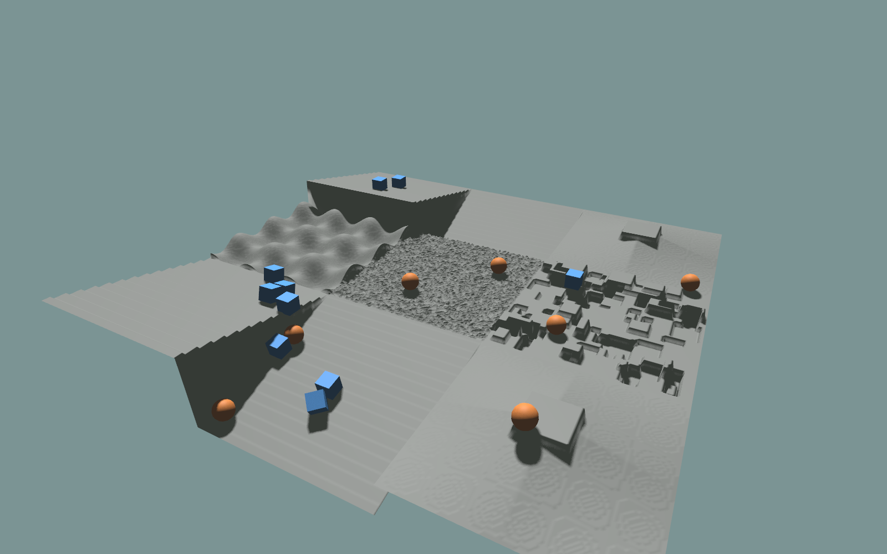
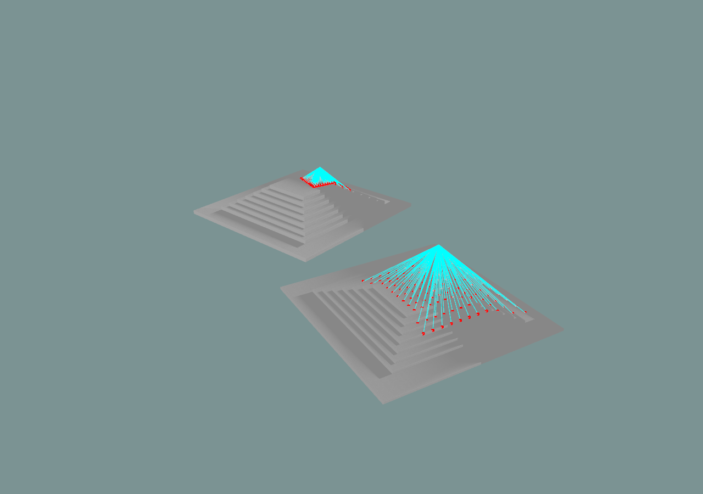

# Procedural Terrain and Collision

KangEngine can generate tiled height-field terrain in Python, render it as one
continuous mesh, and use the same height samples for PhysX collision.

The complete example mixes stairs, slopes, waves, random ground, and discrete
obstacles:

```bash
python ./python/examples/view_procedural_terrain.py
```

It also drops dynamic spheres and boxes onto the terrain to verify that the
rendered surface and PhysX heightfield agree. Press `R` to reset the bodies.

<details>
<summary>Complete source: <code>view_procedural_terrain.py</code></summary>

```{literalinclude} ../../../../python/examples/view_procedural_terrain.py
:language: python
:linenos:
```

</details>



## Generate the height field

`TerrainGrid` joins adjacent tiles with a shared edge, producing one continuous
height field rather than separate mesh islands.

```python
import numpy as np
import kangengine as ke


rng = np.random.default_rng(7)
terrain_types = ("stairs", "slope", "wave", "random", "obstacles")

grid = ke.terrain.TerrainGrid(
    rows=3,
    cols=3,
    tile_width=96,
    tile_length=96,
    horizontal_scale=0.05,
    vertical_scale=0.005,
)


def generate_tile(tile, row, col):
    kind = terrain_types[(row * grid.cols + col) % len(terrain_types)]
    if kind == "stairs":
        ke.terrain.stairs_terrain(tile, step_width=0.35, step_height=0.08)
    elif kind == "slope":
        ke.terrain.sloped_terrain(tile, slope=0.18)
    elif kind == "wave":
        ke.terrain.wave_terrain(tile, num_waves=3.0, amplitude=0.35)
    elif kind == "random":
        ke.terrain.random_uniform_terrain(
            tile, -0.05, 0.05, step=0.01, rng=rng
        )
    else:
        ke.terrain.discrete_obstacles_terrain(
            tile,
            max_height=0.25,
            min_size=0.2,
            max_size=0.7,
            num_rects=80,
            platform_size=1.0,
            rng=rng,
        )
    return tile


grid.fill(generate_tile)
```

`horizontal_scale` is the distance between samples. `vertical_scale` converts
the integer `height_field_raw` values into meters.

## Render the terrain

Convert the grid to `MeshData` and add it through the normal scene API:

```python
mesh = grid.to_mesh(up_axis=ke.UpAxis.Y, backend="cpp")
material = self.create_standard_materials().common

terrain_view = self.scene.add_mesh(
    "/procedural_terrain",
    mesh,
    material,
)
```

The C++ mesh backend is the normal path. Use `backend="python"` when
prototyping or comparing terrain conversion behavior.

## Add PhysX collision

Create collision from the same meter-valued height array:

```python
physics = ke.physics.PhysicsWorld(ke.physics.PhysicsConfig.y_up())
heights = np.ascontiguousarray(grid.height_meters(), dtype=np.float32)

collision_added = physics.add_heightfield(
    heights.reshape(-1),
    grid.width,
    grid.length,
    horizontal_scale=grid.horizontal_scale,
    up_axis=ke.UpAxis.Y,
    center=True,
    register_as_ground=True,
    material=ke.physics.PhysicsMaterialDesc([1.0, 1.0, 0.0]),
)
```

Keep these values identical for rendering and collision:

- height samples from `grid.height_meters()`;
- `horizontal_scale`;
- `up_axis`;
- the `center` setting.

Changing one side independently makes the collision surface appear shifted,
rotated, or scaled relative to the rendered mesh.

Step the `PhysicsWorld` each frame and copy dynamic actor poses to their
`RenderablePrimView` objects. The complete example implements creation, reset,
and synchronization for both spheres and boxes.

## Terrain generators

The public generators modify a `SubTerrain` in place and can be composed:

- `random_uniform_terrain()`
- `sloped_terrain()`
- `pyramid_sloped_terrain()`
- `stairs_terrain()`
- `wave_terrain()`
- `discrete_obstacles_terrain()`

Use a single `SubTerrain` for one patch or a `TerrainGrid` for tiled training
and visualization environments.

## GPU collision and mesh height queries

Use `TerrainMesh` for GPU triangle-mesh collision and height queries.
It converts a height field to a Z-up mesh:

```python
import kangengine as ke

field: ke.terrain.SubTerrain = ke.terrain.SubTerrain(
    width=161, length=161, horizontal_scale=0.05, vertical_scale=0.005)
ke.terrain.random_uniform_terrain(field, min_height=-0.05, max_height=0.05)
asset: ke.terrain.TerrainMesh = ke.terrain.TerrainMesh.from_heightfield(field)
config: ke.physics.PhysicsConfig = ke.physics.PhysicsConfig.z_up()
config.enable_gpu = True
world: ke.physics.PhysicsWorld = ke.physics.PhysicsWorld(config)
instance: ke.terrain.TerrainInstance = asset.create(world, position=(0, 0, 0))
# Optional visualization: instance.add_visual(app.scene, "/terrain", material=material)
# Optional CPU/CUDA float32 tensor query: heights = instance.sample_height(positions)
instance.remove()  # Before closing the viewer or physics world.
```

Install `kangengine[terrain]` to use `sample_height()`. It accepts CPU or CUDA
float32 position tensors and returns heights on the same device; misses return
`-inf`. Pass a render material to `add_visual()` and a physics material to
`create()`.

`PhysicsWorld.add_heightfield()` uses native heightfield collision. PhysX 5.8.0
has a GPU sphere-heightfield boundary-contact error. Use triangle-mesh
collision for GPU terrain where boundary contacts are possible.

## Cast diagonal rays from a robot root

Use `raycast()` when rays should start at the robot root and spread toward the
terrain. Unlike a vertical height scan at fixed XY positions, this pattern can
hit stair risers, and its footprint on level ground grows with the root height.

The interactive example creates a static stair mesh and draws an 11 by 11 fan.
Move the root-height and heading sliders to inspect the hit positions:

```bash
python python/examples/terrain/diagonal_raycast.py
```

Cyan lines hit the terrain, orange lines miss, and yellow points mark hits and
the root. The example requires `kangengine[terrain]` and uses CPU queries.

Build a local fan, rotate it around Z by the robot heading, and cast it against
the same mesh used for rendering and collision:

```python
import torch
import kangengine as ke

asset: ke.terrain.TerrainMesh = ke.terrain.pyramid_stairs_mesh()
grid = torch.linspace(-1.0, 1.0, 11, dtype=torch.float32)
x, y = torch.meshgrid(grid, grid, indexing="ij")
local_directions = torch.stack((x, y, -torch.ones_like(x)), dim=-1)

# All rays share the root origin; only the directions follow its heading.
root = torch.tensor([-2.5, 0.0, 1.2], dtype=torch.float32)
heading = torch.tensor(0.3)
c, s = heading.cos(), heading.sin()
rotation = torch.tensor([[c, -s, 0.0], [s, c, 0.0], [0.0, 0.0, 1.0]])
directions = local_directions @ rotation.T
hits, distances = asset.raycast(
    ray_starts=root, ray_directions=directions, max_distance=6.0
)

valid = torch.isfinite(distances)
relative_heights = hits[..., 2] - root[2]
```

`ray_starts` and `ray_directions` are float32 tensors on the same CPU or CUDA
device, with shape `[..., 3]`. Their leading dimensions broadcast, so one root
position can serve an entire fan. Directions are normalized internally;
`max_distance` and returned distances are in meters. For the example above,
`hits` has shape `[11, 11, 3]` and `distances` has shape `[11, 11]`, on the input
device.

Misses, including zero-length directions, return `+inf` for both positions and
distances. Use the `valid` mask before rendering or passing heights to a policy;
choose the policy's missing-height value explicitly. `sample_height()` keeps
its vertical-query behavior and returns `-inf` on misses.

`TerrainMesh.raycast()` uses mesh coordinates. For a translated scene instance,
use `TerrainInstance.raycast()` with world-space starts and directions; its hit
positions are also in world space. These queries cover the selected static
mesh, not dynamic actors in the physics world.

## Place terrain in separate environments

Use `ke.asset.rigid_from_terrain_mesh()` to reuse a generated `TerrainMesh`
with `GridCloner.add_rigid(..., kinematic=True)`. Each environment then has an
independent rigid pose while sharing the source geometry. See
[Multi-Environment Simulation](MULTI_ENV.md#different-rigid-sources-per-environment)
for the stair batch example and collision constraints, and
[Rigid Bodies](RIGID_BODIES.md) for registration, resets, and visuals.

## Query the authored rigid surface

Ray and height queries require `kangengine[terrain]`. Reuse a populated CPU
`world` with rigid `obj_id=0`, as in the
[per-environment terrain example](MULTI_ENV.md#different-rigid-sources-per-environment).
These queries follow each instance's current pose and its visual parts' local
transforms. They describe the authored visual surface, which may differ from
the simpler physics colliders. They require `visual_geoms` and do not include
other actors.

Cast world-space rays against each selected instance:

```python
import kangengine as ke
import torch

rigids: ke.sim.SimRigidBatch = world.get_rigid_batch(obj_id=0)
positions, quat_xyzw = rigids.get_root_pose()
starts = positions[:, None, :] + torch.tensor([0.0, 0.0, 3.0])
directions = torch.tensor([[[0.2, 0.0, -1.0], [0.0, 0.2, -1.0]]])
hits, distances = rigids.raycast(
    ray_starts=starts, ray_directions=directions, max_distance=6.0
)
```

Float32 input tensors broadcast to `[N, ..., 3]`, where rows follow the selected
environment order. Directions are normalized internally. World hit positions
have shape `[N, ..., 3]`; distances have shape `[N, ...]` in meters. Inputs and
outputs use the same device.

`sample_height()` casts down along world Z, even when a body is tilted. Raycast
misses return `+inf`; height misses return `-inf`. Mask misses before using
results in a policy or drawing them.

### Query devices and environment selection

CPU IDs means a Python integer/list or a CPU integer tensor; `None` selects
all environments in the view. Queries follow the selected environment order.

| Query | Input tensors | `env_ids` |
| --- | --- | --- |
| `get_root_pose()` | None | CPU IDs or `None` |
| `raycast()` / `sample_height()` with CPU poses | CPU or CUDA float32 tensors | CPU IDs or `None` |
| `raycast()` / `sample_height()` with CUDA poses | CUDA float32 tensors | CPU IDs or `None` |

With CPU physics, poses use `state_device` (CPU by default).
CUDA dynamic/kinematic queries return poses on the simulation GPU;
static-only queries use `state_device`. CUDA poses require CUDA ray inputs
and are never implicitly downloaded. Apply queued resets before queries;
ordinary `world.state` snapshots need an explicit refresh. See
[State and Reset](STATE_AND_RESET.md#read-current-rigid-poses) and
[PhysX GPU Simulation](../advanced/PHYSX_GPU.md) for state and initialization rules.

## Try the interactive stair raycast example

Run from the repository root; no external asset files are needed:

```bash
python python/examples/asset/rigid_asset.py
```

With `OBJ_PATHS = ()`, the example creates procedural stairs with step heights
of 0.1 and 0.18 meters. Change environment 1's height, yaw, and pitch with the
sliders while environment 0 stays fixed. Cyan lines show rays; red points mark
surface hits.



Set `OBJ_PATHS` to two OBJ filenames to use your own geometry. Prepare meter-scale,
Z-up meshes with their MTL files and textures. They use kinematic triangle-mesh
collision. Ray queries require `kangengine[terrain]`.
