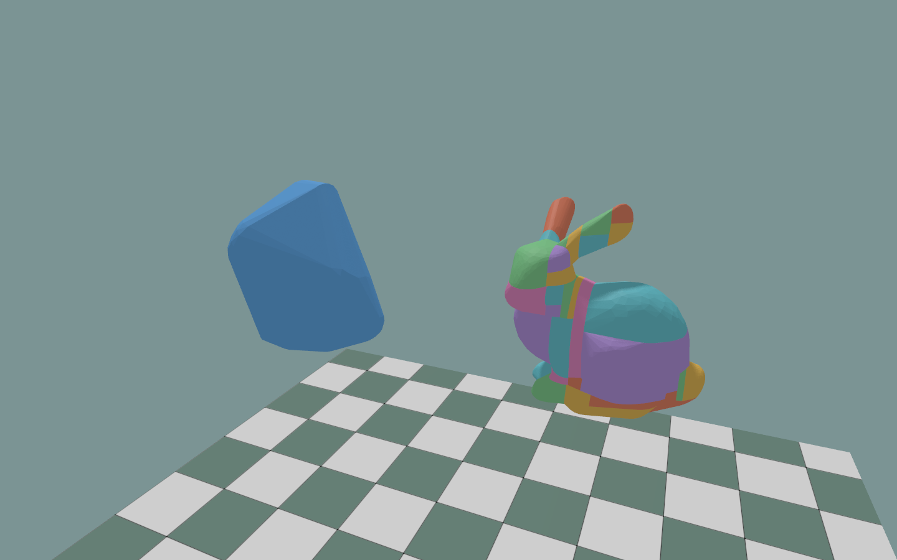
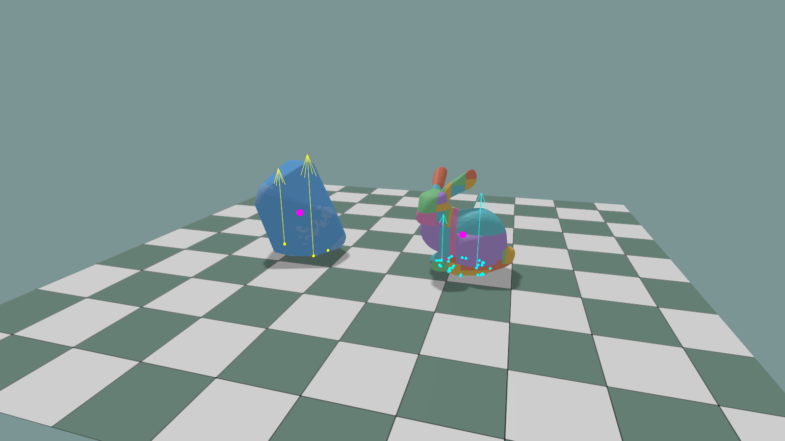
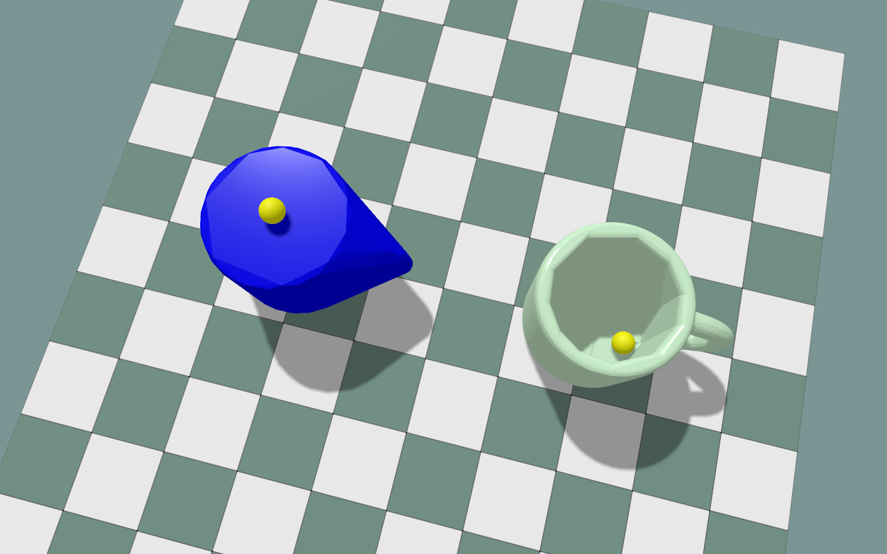

# Convex Decomposition

Split a mesh into convex parts with [CoACD](https://github.com/SarahWeiii/CoACD)
and save them for reuse.

## Setup

Install KangEngine, then run commands from the repository root:

```bash
python -m pip install numpy coacd
```

The tool lives in `python/tools/`, outside the installed KangEngine package.
Saved results need only NumPy. The viewer and MJCF exporter also need KangEngine.

## Decompose the bunny

```python
import numpy as np
import kangengine as ke
import convex_decomposition as decomposition

# Load the OBJ and extract positions and triangle indices.
mesh: ke.scene.MeshData = ke.asset.load_obj(path="assets/external/bunny.obj")
vertices = np.asarray(mesh.vertices, dtype=np.float32)  # (N, 3)
faces = np.asarray(mesh.indices, dtype=np.int64).reshape(-1, 3)  # (M, 3)

# Decompose once, then reuse the saved parts on later runs.
parts: list[decomposition.ConvexPartData]
parts, metadata = decomposition.decompose_mesh(
    vertices=vertices,
    faces=faces,
    options={"threshold": 0.05, "seed": 0},
    result_path="build/convex/bunny/coacd.npz",
)

# Prepare the parts for KangEngine's PhysX collider APIs.
collision_parts: list[ke.physics.ConvexMeshPart] = [
    ke.physics.ConvexMeshPart(vertices=part.vertices, indices=part.faces)
    for part in parts
]
print(f"parts={len(collision_parts)}, cache_hit={metadata['cache_hit']}")
```

Run:

```bash
PYTHONPATH=python/tools python decompose_bunny.py
```

Apply any mesh scale to `vertices` before decomposition. Parts keep the input
frame and units. Creating `collision_parts` prepares data; it does not start a
simulation.

Each part contains `vertices` and `faces`. `metadata` records the backend,
settings, part count, elapsed seconds, and `cache_hit`.

- Existing result file: load it.
- No result file: decompose and save.
- `rebuild=True`: recompute.
- No `result_path`: compute without saving.

Mesh or option changes do not invalidate saved files. Use a new filename or
`rebuild=True` after changes. Loaded metadata describes the saved run.

## Compare collisions

Open the same bunny and reuse the result above:

```bash
python python/examples/compare_convex_collisions.py assets/external/bunny.obj \
  --result build/convex/bunny/coacd.npz
```

The viewer prepares the parts first, then simulates a single convex collider
(left) and a decomposed collider (right). Both drop onto the ground automatically.

:::{figure-md}


Left: one PhysX hull. Right: 41 CoACD parts (`threshold=0.05`, `seed=0`).
Collider shapes before the drop, with source meshes hidden.
:::



After the drop: contact points and force arrows are yellow for the single hull
and cyan for the decomposed collider. Magenta dots mark the centers of mass.
Sleeping bodies keep their last contact sample visible.

Use `--rebuild` after changing the mesh or settings. Without `--result`, the file
is `build/convex/<input-stem>/<backend>.npz`; use separate paths for inputs with
the same stem.

| Control | Action |
| --- | --- |
| Shift + left-drag | Apply force at the picked point in Force mode (the default). |
| Enter | Play / pause. |
| Space | Pause / step. |
| R | Reset. |
| Show CoM | Show centers of mass. |

## Add an algorithm

You can use another decomposition algorithm with the same save/load workflow.

1. Write an adapter that follows `decomposition.ConvexDecompositionBackend`.
   Give it a `name`, a `version`, and a `decompose(vertices, faces, options)` method.
2. In `decompose()`, call your algorithm and return one
   `decomposition.ConvexPartData(vertices, faces)` per convex part as a list.
   Keep the input coordinate frame and units.
3. Register the adapter, then pass its name to `decompose_mesh()`:

```python
decomposition.register_convex_decomposition_backend(backend=adapter)
parts, metadata = decomposition.decompose_mesh(
    vertices=vertices,
    faces=faces,
    backend=adapter.name,
)
```

The adapter interface is experimental and may change.

## Export a cup to MJCF

Decompose the cup OBJ and export it as one free rigid body:

```bash
python python/tools/mesh_to_mjcf.py assets/objects/cup/cup.obj \
  --output-dir build/convex/cup/mjcf
```

This saves `cup.xml`, `meshes/visual.obj`, `meshes/part_*.obj`, and `coacd.npz`.
Use `--rebuild` after input changes, or `--result path/to/result.npz` to reuse a
decomposition saved elsewhere. Materials and textures are not exported.

Input coordinates use Y up and meters. Mass properties use a density of 1 kg/m³.
Add `--mass 0.3` to set the total mass to 0.3 kg; inertia scales to match.

In `cup.xml`, the original mesh is visual-only. Each convex part becomes a
collision geom on the same body:

```xml
<mujoco model="cup">
  <compiler angle="radian" meshdir="meshes" />
  <option gravity="0 -9.81 0" />
  <default>
    <default class="collision">
      <geom type="mesh" group="3" />
    </default>
  </default>
  <asset>
    <mesh name="visual" file="visual.obj" />
    <mesh name="part_000" file="part_000.obj" />
    <mesh name="part_001" file="part_001.obj" />
    <!-- Remaining part meshes omitted. -->
  </asset>
  <worldbody>
    <body name="cup">
      <joint name="root" type="free" />
      <geom name="visual" type="mesh" mesh="visual"
            contype="0" conaffinity="0" group="1" density="0" rgba="0.8 0.8 0.8 1" />
      <geom name="part_000" class="collision" mesh="part_000" />
      <geom name="part_001" class="collision" mesh="part_001" />
      <!-- Remaining collision geoms and computed inertial element omitted. -->
    </body>
  </worldbody>
</mujoco>
```

:::{figure-md}


Left: PhysX convex hull. Right: CoACD result.
:::
