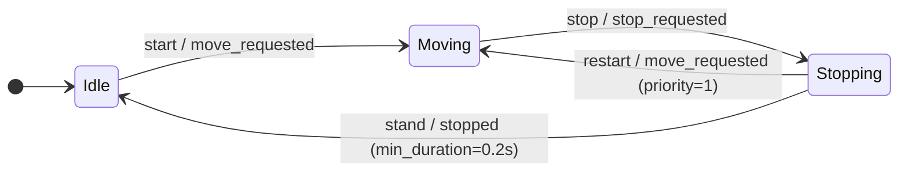

# Batch Finite State Machine

`ke.utils.BatchFSM` selects states from named signals for independent batch
entries. Use it for task stages, environment control, or character behavior.
`num_envs` sets the batch size; use `1` for a single state machine. It runs on
CPU or CUDA and has no dependency on animation or physics.

The caller computes signals -> `fsm.step()` updates states -> the caller performs
actions. **The FSM does not call those actions automatically.**

## Inputs and results

| Value | Direction | Meaning |
| --- | --- | --- |
| `signals` | Caller -> FSM | Boolean `[N]` conditions supplied by the caller |
| `changed` | FSM -> caller | Boolean `[N]`: a transition occurred in this call |
| `fsm.state_ids` | Updated by FSM | The current state index for each batch entry |

`states` maps stable IDs to display labels. Each `FSMTransition` defines an
edge using `id`, `source`, `target`, and a named `condition`. Definitions are
separate from runtime tensors, so they can also be inspected or drawn as a graph.

## Example: motion playback

Each edge below shows its transition ID and signal. This matches the code example.



```python
import torch
import kangengine as ke

fsm: ke.utils.BatchFSM = ke.utils.BatchFSM(
    # Stable state ID -> display label; each environment has its own state.
    states={"idle": "Idle", "moving": "Moving", "stopping": "Stopping"},
    # Transition ID, source state, target state, signal supplied to step().
    transitions=[
        ke.utils.FSMTransition("start", "idle", "moving", "move_requested"),
        ke.utils.FSMTransition("stop", "moving", "stopping", "stop_requested"),
        # Prefer restarting when move_requested and stopped are both true.
        ke.utils.FSMTransition(
            "restart", "stopping", "moving", "move_requested", priority=1
        ),
        ke.utils.FSMTransition(
            "stand", "stopping", "idle", "stopped", min_duration=0.2
        ),
    ],
    initial_state="idle",
    num_envs=4,
    device="cpu",
)
```

`stopped` means the playback policy has reached a pose safe to hold, such as a
standing clip after its transition. Zero movement input requests stopping;
it does not prove that a raised foot has reached the ground.

The positional arguments of `FSMTransition` are `id`, `source`, `target`,
and `condition`. For example, `"restart", "stopping", "moving", "move_requested"`
names an edge that leaves Stopping for Moving when `move_requested` is true.

**Larger `priority` numbers win: `2` before `1` before `0`.** The default is `0`;
equal priorities use definition order. In the example, `restart` has priority
`1` and `stand` has priority `0`, so a new movement request wins when both
transitions are eligible. Each environment takes at most one edge per call.
`min_duration` measures time in the source state, including this step's `dt`.
Entry resets `elapsed` to zero. Self-transitions
also reset the clock and report `changed=True`.

`transitions` retains immutable edge definitions in their original order.
Runtime `state_ids` and `transition_ids` are integer indices, not stable IDs.
`transition_ids` is `-1` when no edge was taken. Runtime tensors are borrowed
read-only views; clone them to keep history. No editor or graph executor is needed.

### Update states and perform actions

The code below connects the FSM above to an already prepared **CPU**
`MotionMatchingBatchController` named `batch`, also with four environments.
This minimal policy holds or resumes the currently selected clips.

```python
# Once at setup: match playback to the FSM's initial Idle state.
batch.hold()
idle_idx = fsm.state_idx("idle")


def update_playback(move_requested, stopped, dt):
    # 1. Remember the old state, then pass the caller's conditions to the FSM.
    was_idle = fsm.state_ids == idle_idx
    changed = fsm.step(
        dt=dt,
        signals={
            "move_requested": move_requested,
            "stop_requested": ~move_requested,
            "stopped": stopped,
        },
    )

    # 2. Identify which environments entered or left Idle this step.
    idle = fsm.state_ids == idle_idx
    entering_idle = changed & idle
    leaving_idle = changed & was_idle

    # 3. The caller performs the actions; the FSM only chose the states.
    if entering_idle.any():
        batch.hold(env_ids=entering_idle.nonzero().flatten())
    if leaving_idle.any():
        batch.resume(env_ids=leaving_idle.nonzero().flatten())

    batch.advance(dt=dt)
    return batch.sample_robot_state()


# Example inputs for one control step: environments 0 and 2 request movement.
move_requested = torch.tensor([True, False, True, False])
stopped = torch.zeros(4, dtype=torch.bool)
state, bodies = update_playback(move_requested, stopped, dt=1 / 60)
```

On this first call, `changed` is `[True, False, True, False]`: environments
0 and 2 enter Moving and resume playback. When movement input later becomes
false, they enter Stopping but keep playing. Only after `stopped` becomes true
and the minimum state duration is met do they enter Idle and call `hold()`.

The caller also owns query construction and search timing, as shown in
[batch motion matching](../animation/MOTION_MATCHING.md#batch-targets-for-imitation-learning).
To leave Idle into a newly searched clip, call `transition()` directly instead
of resuming the old clip first; the Newton examples use this pattern.

`hold()` freezes playback and transition clocks, preserving the final output
pose. All root, joint, body, and reference velocities become zero, including in
future samples. `resume()` blends from that pose and zero velocity;
`transition()` can resume directly into another clip. With a zero transition
half-life, source velocity resumes immediately. `reset()` clears hold.

`select()` does not change held rows, but still computes distances for supplied
queries. To save search work, omit idle rows or skip the call entirely.
On CUDA, reuse scheduler-provided integer indices when available; converting
a device mask to variable-length indices can synchronize with the CPU.
FSM updates themselves stay on their tensor device without host reads.

The [Newton G1 example](../animation/MOTION_MATCHING.md#batch-targets-for-imitation-learning)
keeps keyboard scheduling on CPU. Leaving Idle selects a start clip directly
from the held pose, with a short delay before periodic searches resume.
Moving rows search every six steps and exclude stop clips. Stopping rows
select a stop clip once and play its remaining braking and foot-plant motion
before holding. Idle rows do no query construction or search. This clip-based
policy is example-specific; contact-based stopping can supply the same
`stopped` signal.
